# Kafka 知识点与项目实战

> 复习主线：围绕“一条消息如何可靠、有序地从 Producer 写入 Broker，再由 Consumer 可控地处理”展开。

## 1. 一句话定位

Kafka 是分布式事件流平台，也可以理解为分布式提交日志。它常用于系统解耦、异步处理、削峰、数据同步、日志采集和流式计算。

```text
Producer 产生业务事件
    -> Topic 对事件分类
    -> Partition 提供并行度和局部顺序
    -> Replica 提供容灾
    -> Consumer Group 分摊消费
    -> Offset 记录组内消费进度
```

版本敏感点：截至 2026 年官方最新文档为 Kafka 4.3。Kafka 4.x 只支持 KRaft，ZooKeeper 模式已移除；新一代 Consumer Rebalance Protocol 从 4.0 起 GA，但客户端仍需通过 `group.protocol=consumer` 主动启用，当前默认仍是 `classic`。

---

## 2. 核心概念

| 概念 | 含义 | 面试关键词 |
|---|---|---|
| Event / Record | 一条事件，包含 key、value、timestamp、headers | 业务事实 |
| Topic | 消息逻辑分类 | 多生产者、多订阅者 |
| Partition | Topic 的有序追加日志分片 | 并行度、局部有序 |
| Offset | 消息在 Partition 中的位置 | Consumer 进度 |
| Broker | 存储和处理分区数据的服务节点 | 集群节点 |
| Replica | Partition 的数据副本 | Leader、Follower、ISR |
| Consumer Group | 一组协作消费者 | 组内负载均衡、组间广播 |
| Controller | 管理元数据、分区状态和 Leader 选举 | KRaft controller quorum |

### 2.1 Topic、Partition 与 Offset

```text
order-topic
├── partition-0: offset 0, 1, 2, 3 ...
├── partition-1: offset 0, 1, 2, 3 ...
└── partition-2: offset 0, 1, 2, 3 ...
```

Kafka 只保证同一 Partition 内按写入顺序读取，不保证多个 Partition 之间的全局顺序。

### 2.2 Consumer Group

同一个 Group 内，一条 Partition 同一时刻只分配给一个 Consumer；一个 Consumer 可以负责多个 Partition。

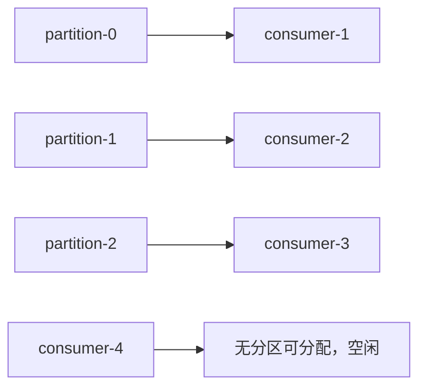

因此组内有效消费并行度上限通常不超过 Partition 数。不同 Group 订阅同一 Topic 时，每个 Group 都能独立读取一份事件，形成广播效果。

---

## 3. Producer 完整发送流程

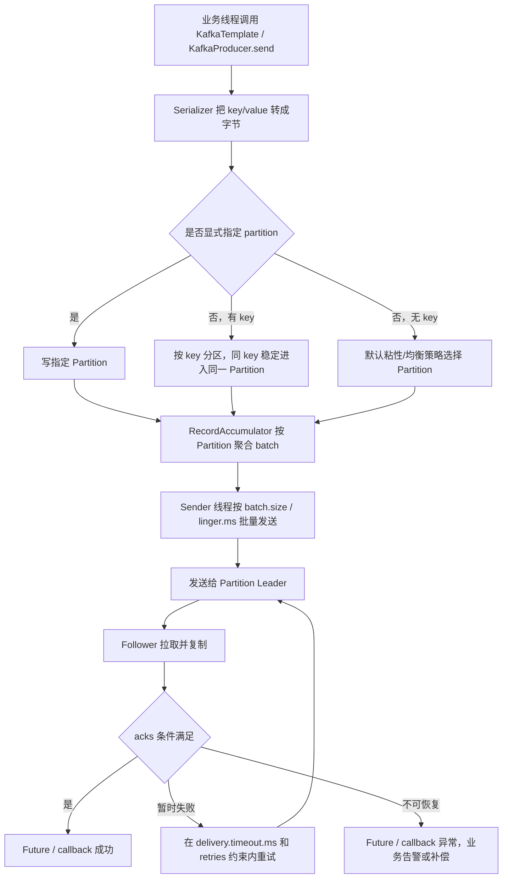

### 3.1 高频参数

| 参数 | 作用 | 关注点 |
|---|---|---|
| `bootstrap.servers` | 初始集群地址 | 配多个地址；客户端会发现完整集群 |
| `key/value.serializer` | 序列化 | 上下游格式兼容、Schema 演进 |
| `acks` | 写入确认强度 | 当前版本默认 `all` |
| `enable.idempotence` | Broker 端按 PID 和序列号去重 | Kafka 3.0 起默认 `true`，冲突配置可使其失效 |
| `retries` | 可重试异常的自动重试 | 当前默认很大，通常用 `delivery.timeout.ms` 控制总时限 |
| `delivery.timeout.ms` | 单条消息发送总时限 | 包含等待、发送和重试 |
| `batch.size` | 每分区批次上限 | 大批次提高吞吐但占内存 |
| `linger.ms` | 等待更多消息形成批次 | Kafka 4.0 起默认 5ms |
| `compression.type` | 批次压缩 | `lz4`、`zstd` 等可减少网络和磁盘 |
| `buffer.memory` | Producer 缓冲区 | 满后受 `max.block.ms` 限制 |
| `max.in.flight.requests.per.connection` | 单连接未确认请求数 | 关闭幂等时重试可能造成乱序 |

### 3.2 `acks`、ISR、`min.insync.replicas`

| `acks` | 返回条件 | 风险 |
|---|---|---|
| `0` | 不等待 Broker 响应 | 发送端无法确认丢失，重试也难生效 |
| `1` | Leader 本地写入后返回 | Leader 在副本同步前故障可能丢失 |
| `all` | 当前 ISR 全部确认 | 最强内置保证，但要配合副本和最小 ISR |

推荐理解，不是机械背配置：

```text
replication.factor = 3
min.insync.replicas = 2
acks = all

当前 ISR 为 3：3 个 ISR 都确认后成功
当前 ISR 为 2：2 个 ISR 都确认后成功
当前 ISR 为 1：低于 min ISR，写入失败而不是只写一份
```

`min.insync.replicas` 不是“只等指定数量副本确认”，而是设置允许写入的最低 ISR 门槛；`acks=all` 仍等待当前全部 ISR。

---

## 4. 分区、副本与 Leader 选举

### 4.1 AR、ISR、OSR

```text
AR  = Assigned Replicas，分配给该分区的全部副本
ISR = In-Sync Replicas，当前保持同步且有资格承担可靠写入的副本
OSR = AR - ISR，落后或不满足同步条件的副本
```

Producer 和 Consumer 主要与 Leader 交互，Follower 从 Leader 拉取数据。Follower 长时间未追上会退出 ISR；恢复追平后可重新加入。

### 4.2 KRaft

Kafka 4.x 不再依赖 ZooKeeper。KRaft controller quorum 使用 Raft 管理集群元数据，Controller 负责 Broker 注册、Topic/Partition 元数据和 Leader 选举等控制面工作。

### 4.3 新版本 ELR

Kafka 4.0 引入 Eligible Leader Replicas，4.1 起在新集群默认启用。它在严格 `min.insync.replicas` 语义基础上，记录部分虽不在 ISR 但仍安全的候选副本，改善 Leader 选举可用性。基础面试先讲 ISR；被追问新版本复制改进时再补充 ELR。

---

## 5. Consumer、Offset 与 Rebalance

### 5.1 消费流程

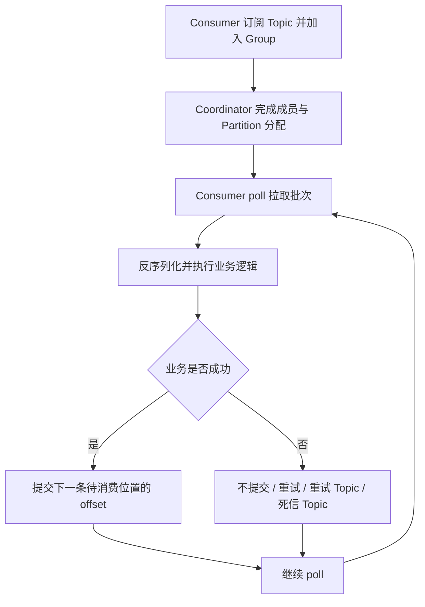

提交的 offset 通常存储在 Kafka 内部压缩 Topic `__consumer_offsets`。

### 5.2 自动与手动提交

- 自动提交简单，但提交时机可能早于业务完成。
- 手动提交应在业务成功后执行，通常形成 at-least-once：处理成功但提交失败时会重复消费。
- 批量消费时必须定义“部分成功、部分失败”如何处理，不能只把整批 ack 当作技术细节。

### 5.3 Rebalance

触发原因：Consumer 加入/离开、心跳或会话超时、`poll` 间隔超过 `max.poll.interval.ms`、Partition 数变化、订阅变化。

影响：短暂停顿、Partition 转移、重复消费、缓存重建、消费延迟增大。

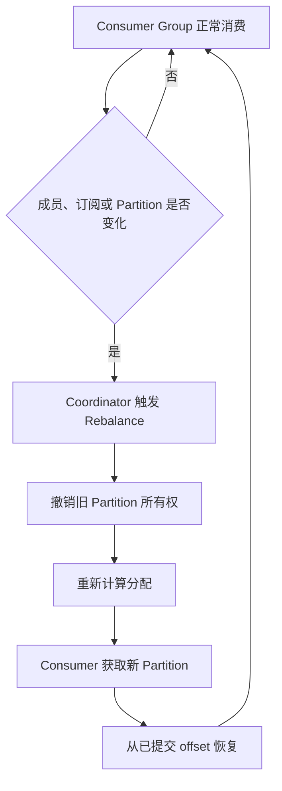

优化思路：

1. 缩短单批处理时间，调小 `max.poll.records`。
2. 合理设置 `max.poll.interval.ms`，不要用超大值掩盖阻塞。
3. 慢业务从 poll 线程解耦时，正确管理 pause/resume、顺序和 offset。
4. 使用静态成员 `group.instance.id` 减少短暂重启引发的重分配。
5. Kafka 4.x 可评估新 Consumer 协议，它是增量式且减少全局同步屏障；不能把 Classic 协议参数直接照搬。

---

## 6. 消息语义、丢失、重复与顺序

### 6.1 三种语义

| 语义 | 处理顺序 | 结果 |
|---|---|---|
| At-most-once | 先提交 offset，再处理 | 可能丢，不重复 |
| At-least-once | 先处理，成功后提交 | 尽量不丢，可能重复 |
| Exactly-once | 原子协调输入 offset 与输出 | 只在明确边界内成立 |

Kafka 的 Exactly Once 在 Kafka-to-Kafka、Kafka Streams 或事务 Producer + `read_committed` Consumer 中较完整。`Kafka -> MySQL/HTTP/Redis` 不会因为开启 Kafka 事务就自动全局 Exactly Once，仍需外部系统配合、幂等或把 offset 与输出状态放入同一事务边界。

### 6.2 不丢消息要从三端回答

#### Producer

- `acks=all`、幂等 Producer、合理 `delivery.timeout.ms`。
- 处理异步 `send` 的 Future/callback 异常。
- 发送失败需要告警和可追踪补偿，不能只写一条日志。

#### Broker

- 合理副本因子与 `min.insync.replicas`。
- 监控 ISR shrink、Under Replicated Partitions、磁盘和 Controller 状态。
- Topic 动态创建时不能使用生产不合适的默认副本数。

#### Consumer

- 关闭不合适的自动提交。
- 业务成功后手动提交。
- 失败进入受控重试，不能无限原地重试阻塞 Partition。
- 业务侧必须幂等。

### 6.3 重复消费的幂等方案

1. 数据库唯一索引，如 `message_id` 或业务单号。
2. 业务状态机只允许合法状态迁移。
3. 去重表记录消息 ID 与处理结果。
4. Redis `SET key value NX EX` 做短期快速去重，并以数据库兜底。
5. 更新型事件使用版本号，忽略旧版本或重复版本。

### 6.4 顺序性

```text
Producer：同一业务 ID 作为 key，进入同一 Partition
Broker：保证单 Partition 追加顺序
Consumer：同一 Partition 按序处理，异步线程池不能打乱提交和副作用
重试：失败消息若转移到其他 Topic，需明确是否允许后续消息越过
```

全局有序通常只能使用单 Partition，代价是吞吐和扩展能力下降。实际业务更常见的是“同一订单/运单有序”。

---

## 7. Kafka 为什么快

1. Partition 日志使用追加式顺序写。
2. 大量利用操作系统 Page Cache。
3. 发送文件数据时使用零拷贝路径减少用户态拷贝。
4. Producer 按 Partition 批量聚合，并支持压缩。
5. 多 Partition 可分布到多个 Broker 并行读写。
6. Consumer Pull 模型自行控制拉取节奏。


---

## 8. 存储、保留与压缩

每个 Partition 是一条逻辑日志，物理上切成多个 Segment：

```text
00000000000000000000.log
00000000000000000000.index
00000000000000000000.timeindex
```

查询时先按 offset 定位 Segment，再通过稀疏索引找到附近物理位置，最后顺序扫描。

| 策略 | 说明 | 典型场景 |
|---|---|---|
| `cleanup.policy=delete` | 按 `retention.ms/bytes` 删除旧 Segment | 业务事件、日志 |
| `cleanup.policy=compact` | 保留同 key 的最新值，并保留 tombstone 语义 | 配置、状态、CDC 维表 |

Kafka 消费后不会立即删除消息。消费者靠 offset 独立读取，因此可回溯，但前提是消息仍在保留窗口内。

---

## 9. 消息积压排查

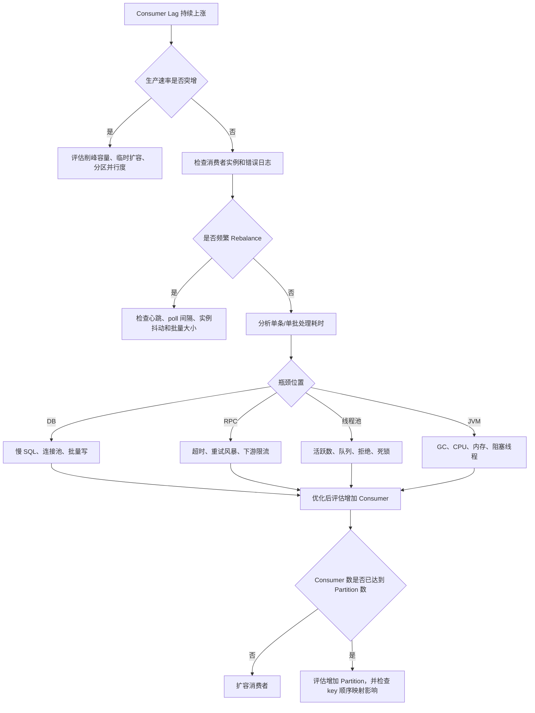

紧急处置要先保护下游，再追吞吐。临时新建 Consumer Group 会从自己的 offset 开始消费，不能简单认为它能替原组清理积压。

---

## 10. 重试与死信

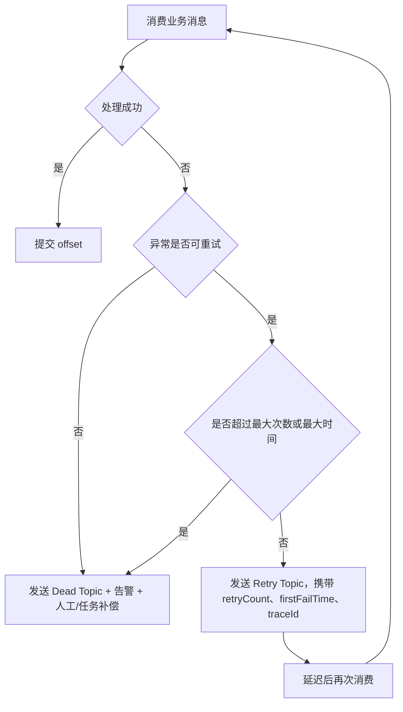

重试设计必须回答：

- 立即重试还是延迟重试。
- 是否阻塞原 Partition。
- 重试后是否仍需同 key 有序。
- 重试次数、退避、超时时间。
- 死信如何查询、修复、重放和审计。
- 原消息何时提交 offset，重试消息发送失败怎么办。

---

## 11. 当前项目使用全景

扫描范围：`D:\ai-work-project` 下全部一级项目。以下为 `@KafkaListener` 静态命中数量和生产端封装命中情况，用于表示使用密度，不代表运行时流量。

| 项目 | Listener 数 | 生产端命中 | 主要用途 |
|---|---:|---:|---|
| `ka-waybil-router` | 156 | 1 | 按平台/客户路由事件，多个独立处理器并行扩展 |
| `ka-solution` | 30 | 多处间接调用公共 Producer | 网点、工单、费用、电子签、客户定制事件 |
| `ka-monitor` | 21 | 4 | 监控日志、跟进分析、告警和多数据源 Kafka 配置 |
| `ka-order` | 5 | 1 | 异步下单/合单、订单重试、价格确认 |
| `ka-retry` | 1 | 1 | 通用重试消息落库、调度和再次发送 |
| `ka-consumer` | 1 | 0 | 消费示例/辅助处理 |
| `ka-common` | 0 | 4 | 统一 Producer、消息模型、消费者模板、Topic 常量 |

其余项目未发现明显的直接 Kafka Listener，可能通过公共模块、Feign 或其他服务间接参与链路。

### 11.1 案例一：公共 Producer 封装

源码：`ka-common/ka-common/.../kafka/KafkaProducer.java`

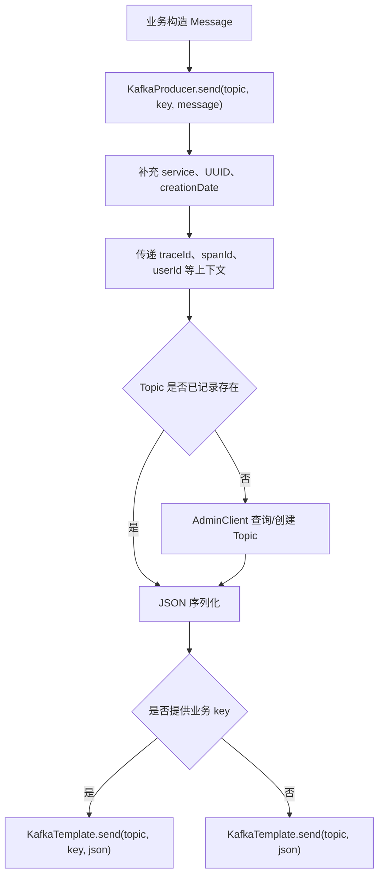

实际工作价值：统一消息元数据和链路上下文，业务传 `orderId`、`waybillNumber` 等 key 时可保证同业务维度落到同一 Partition。

边界：`KafkaTemplate.send` 是异步的，公共封装当前没有显式处理 Future/callback；对高可靠消息，应记录最终发送失败、告警并补偿。动态创建 Topic 的默认 Partition/副本配置也应由平台治理，生产副本数不能依赖开发默认值。

### 11.2 案例二：统一批量消费和手动提交

源码：

- `ka-monitor/.../config/KafkaConfiguration.java`
- `ka-common/.../kafka/support/MessageConsumerSupport.java`
- `ka-common/.../kafka/support/DefaultMessageConsumer.java`
- `ka-common/.../kafka/support/ListableMessageConsumer.java`

配置层定义：

```text
ConcurrentKafkaListenerContainerFactory
  -> setBatchListener(true)
  -> setConcurrency(concurrency)
  -> AckMode.MANUAL_IMMEDIATE
  -> max.poll.records / max.poll.interval.ms 等参数
```

模板层定义：

```text
批量 List<String> 进入
  -> 判断标准 Message 包装或历史裸 JSON
  -> 透传并打印原 traceId
  -> 反序列化为泛型对象
  -> 单条或批量业务处理
  -> finally acknowledgment.acknowledge()
```

价值：统一兼容消息格式、链路追踪、反序列化、耗时日志和 ack，业务 Listener 只实现 `consumeMessage`。

可靠性边界：`MessageConsumerSupport` 在 `finally` 中无条件 ack，下层又会捕获处理异常，因此失败消息也可能提交 offset。这更接近“主流程不被坏消息阻塞”的策略，但不是严格 at-least-once。关键交易事件应明确失败落重试/死信的保证，并监控“捕获异常后仍 ack”的丢处理风险。

### 11.3 案例三：异步合单

源码：

- `ka-order/.../listener/order/SaveOrderListener.java`
- `ka-order/.../listener/order/RetryOrderListener.java`

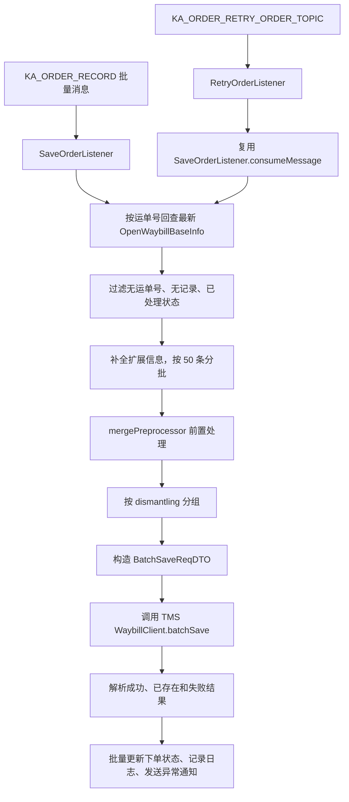

实际工作总结：Kafka 把前台下单与合单/TMS 批处理解耦，Listener 通过状态过滤实现一层业务幂等，并把 50 条作为下游批次；重试 Topic 复用同一业务入口，避免主流程和重试流程分叉。

需要继续关注：当前批量模板最终无条件 ack，单批中的异常可能只记录日志；必须确认失败状态是否都能进入重试 Topic或被任务扫描，否则会出现“Kafka 已确认但业务未完成”。

### 11.4 案例四：运单路由分发

代表源码：

- `ka-waybil-router/.../handler/route/zijie/handler/ZiJieRouteHandler.java`
- `ka-waybil-router/.../util/KafkaUtils.java`

该项目包含约 156 个 `@KafkaListener`，大量 Handler 按 `topic base + platformFlag` 订阅不同平台/客户路由消息。例如 ZiJie Handler 接收批量字符串，解析后执行对应平台的路由推送。

```text
上游产生运单路由事件
  -> 按平台标识选择 Topic
  -> Kafka Partition 承接吞吐和顺序
  -> 对应平台 Handler 消费
  -> 转换客户协议并推送
  -> 独立记录成功/失败和补偿
```

设计价值：新增客户可新增 Topic/Handler，避免一个超大 `if-else`；不同平台故障隔离、可独立扩容。治理重点是 Topic 数、Group ID 唯一性、错误重试、客户端发送回调和监听器配置一致性。

### 11.5 案例五：节点消息幂等和一对多业务动作

源码：`ka-solution/.../listener/NodeInfoListener.java`

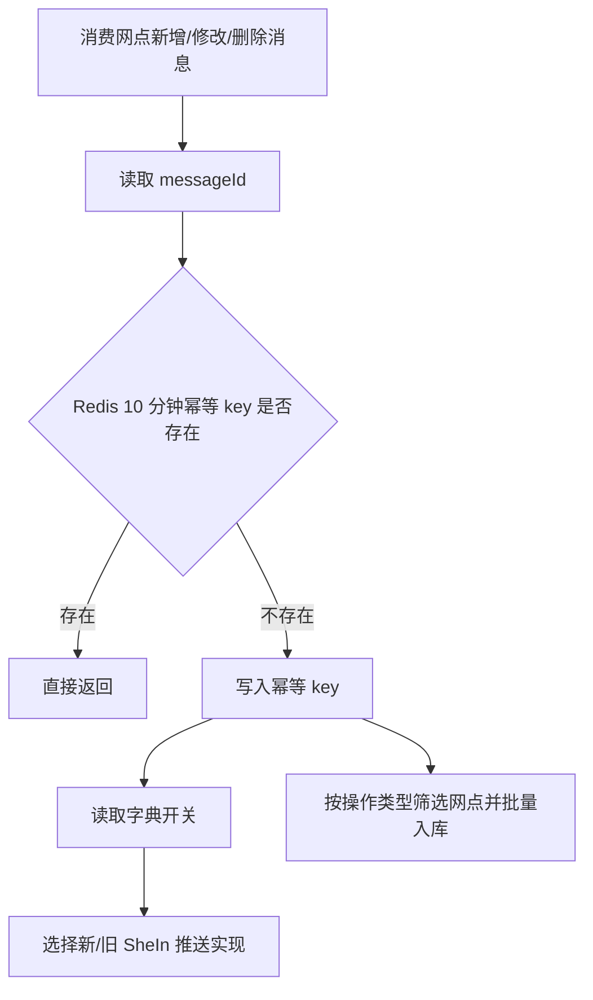

这是 Kafka 至少一次语义与 Redis 去重的组合。更严格时应把 `GET + SET` 改为原子 `SET NX EX`，并在数据库使用唯一键或业务状态机兜底。

### 11.6 案例六：消费后再生产，并用业务 key 保序

源码：`ka-solution/.../listener/ecsign/TencentSignResultNotifyListener.java`

流程：消费电子签回调 Topic，根据供应商类型选择 `EcSignSupport` 实现，保存签署结果后构造回调事件，再调用公共 `KafkaProducer.send`，以 `waybillNumber` 作为 key 发送到同步 Topic。

```text
电子签结果事件
  -> 按 supplierType 选择处理策略
  -> 保存签署结果
  -> 构造 EcSignCallBackData
  -> 以 waybillNumber 为 key 发送下游 Topic
```

这能保持同一运单后续事件的 Partition 一致性，但当前数据库保存与下游 Kafka 发送不是一个原子事务。需要通过幂等、Outbox、本地消息表或失败补偿解决“库成功但消息失败”等双写问题。

### 11.7 案例七：通用重试中心

源码：`ka-retry/.../listener/RetryKafkaListener.java`

重试中心批量消费统一重试 Topic，解析 `RetryMessageBO`，校验重试规则并持久化/调度。它让各业务不必在原 Listener 内无限重试。

边界：该 Listener 最终也会 ack 整批消息。需要确保每一条失败记录在 ack 前已可靠写入重试存储；若写入失败，不能只记录日志后确认。

---

## 12. 项目工作内容总结

可以把当前项目的 Kafka 实际工作归纳为四类：

1. **异步业务处理**：订单合单、价格确认、电子签结果、网点同步。
2. **客户/平台路由**：一个业务事件按平台 Topic 分发到大量独立 Handler。
3. **可观测性**：Producer 统一补充 traceId、spanId、service、messageId；监控模块批量消费日志和分析事件。
4. **可靠性补偿**：统一重试 Topic、业务状态过滤、Redis 幂等、重试 Listener。

项目的主要设计取舍是：批量消费和无条件 ack 优先保证吞吐及不阻塞，但关键链路必须额外确保失败落库、重试或告警。面试时把这个取舍讲出来，比只背 `enable.auto.commit=false` 更贴近真实工作。

---

## 13. 复习流程图

### 13.1 总复习路线

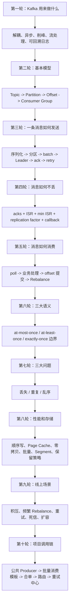

### 13.2 每个 Kafka 题目的固定复习模板

```text
定义
  -> 事件在 Producer / Broker / Consumer 哪一端
  -> 正常执行流程
  -> 故障时会发生什么
  -> 关键参数及相互约束
  -> 吞吐、延迟、可靠性的取舍
  -> 当前项目源码案例
  -> 监控指标和补偿方案
```

### 13.3 每日 30 分钟复习法

1. 5 分钟默画 Producer 完整发送链路。
2. 5 分钟解释 `acks`、ISR、`min.insync.replicas`。
3. 5 分钟解释 Consumer Group、Offset、Rebalance。
4. 5 分钟分别回答不丢、不重、保序。
5. 5 分钟排查一次消息积压。
6. 5 分钟讲一个项目案例，并主动补充该实现的失败边界。

---

## 14. 面试讲解流程图

### 14.1 3 到 5 分钟主线

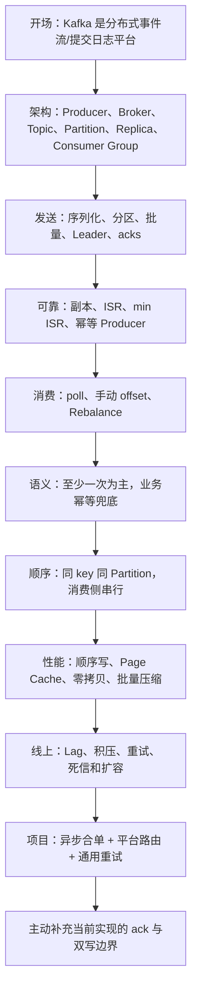

### 14.2 可直接口述的项目答案

> 我们项目中 Kafka 主要用于异步下单、运单路由、客户方案事件、监控日志和统一重试。公共模块封装了 `KafkaProducer`，发送时统一补充消息 ID、服务名和链路上下文；需要同业务有序时，会使用订单号或运单号作为 key。消费侧通过 Spring Kafka 的批量 Listener 和手动即时 ack 统一处理，公共模板兼容标准 Message 和历史 JSON 格式。
>
> 一个代表链路是订单异步合单：`SaveOrderListener` 批量消费订单记录，回查最新状态做业务幂等，按 50 条拆批，调用 TMS 批量下单，再更新结果；失败重试 Topic 复用同一套处理逻辑。运单路由项目则有大量按平台拆分的 Handler，新增客户可以新增独立 Topic 和 Listener，便于故障隔离和独立扩容。
>
> 可靠性上我会从三端保证：Producer 关注 `acks=all`、ISR、幂等和发送回调；Broker 关注副本因子和 `min.insync.replicas`；Consumer 在业务成功后提交 offset，并通过唯一键、状态机或 Redis 去重保证幂等。我们当前公共消费模板在 `finally` 中 ack，所以关键消息必须确保异常已可靠进入重试或死信，否则会有“消息已确认但业务未完成”的风险。

### 14.3 追问连接图

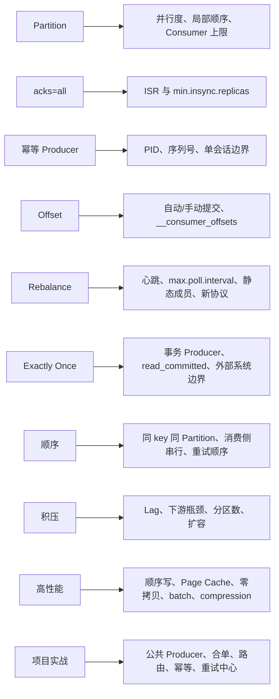

---

## 15. 高频自测题

1. Kafka 的 Topic、Partition、Offset、Consumer Group 分别解决什么问题？
2. 为什么 Consumer 数超过 Partition 数后不能继续提高组内并行度？
3. Producer 从 `send` 到 Broker ack 的完整流程是什么？
4. `acks=all` 是否只等 `min.insync.replicas` 个副本？
5. ISR 缩小会造成什么可靠性和可用性影响？
6. Kafka 4.x 的 KRaft 与过去 ZooKeeper 模式有什么变化？
7. 什么触发 Rebalance，如何减少其影响？
8. 自动提交为什么可能丢消息？手动提交为什么仍会重复？
9. Kafka Exactly Once 在什么边界内成立，为什么不能自动覆盖 MySQL？
10. 如何保证同一订单事件有序？重试 Topic 会怎样破坏顺序？
11. Kafka 为什么快？Segment 和稀疏索引起什么作用？
12. Consumer Lag 上涨时按什么顺序排查？
13. 当前项目 `MessageConsumerSupport` 的 ack 策略是什么，风险在哪里？
14. `SaveOrderListener` 如何做批处理和业务幂等？
15. 公共 `KafkaProducer` 使用业务 key 有什么价值，异步发送还缺什么保障？

---

## 16. 官方资料

- [Kafka 4.3 文档首页](https://kafka.apache.org/documentation/)
- [Kafka 4.3 升级说明与 KRaft](https://kafka.apache.org/43/getting-started/upgrade/)
- [Kafka 核心设计与消息语义](https://kafka.apache.org/design/)
- [Kafka Producer 配置](https://kafka.apache.org/43/generated/producer_config.html)
- [Kafka Consumer 配置](https://kafka.apache.org/43/generated/consumer_config.html)
- [Kafka Topic 配置与 min.insync.replicas](https://kafka.apache.org/43/configuration/topic-configs/)
- [Kafka 新 Consumer Rebalance Protocol](https://kafka.apache.org/43/operations/consumer-rebalance-protocol/)
- [Kafka Eligible Leader Replicas](https://kafka.apache.org/43/operations/eligible-leader-replicas/)
- [Kafka Producer 4.3 API 与幂等/事务说明](https://kafka.apache.org/43/javadoc/org/apache/kafka/clients/producer/KafkaProducer.html)
