# Redis 知识点与项目实战

> 复习主线：先回答 Redis 为什么快，再掌握数据结构和内存管理，接着理解持久化与高可用，最后落到缓存、分布式锁、限流和项目排障。

## 1. 一句话定位

Redis 是以内存为主的数据结构服务器。它不仅是缓存，还可以承担计数、去重、排行榜、限流、分布式锁、会话、延迟任务和轻量事件流等能力。

Redis 的核心价值不是单纯“快”，而是：

```text
用合适的数据结构
    +
把高频读写从慢存储前移到内存
    +
通过过期、淘汰、持久化、复制和集群管理数据生命周期
```

---

## 2. Redis 为什么快

1. 数据主要位于内存，避免频繁磁盘随机 I/O。
2. 核心命令执行路径以串行为主，减少锁竞争和线程切换。
3. 使用 I/O 多路复用管理大量连接。
4. SDS、Dict、Listpack、QuickList、SkipList 等结构针对具体场景优化。
5. Pipeline、批量命令和 Lua 能减少网络往返及客户端竞争窗口。
6. 持久化、异步删除、复制和现代版本的网络 I/O 可以使用后台线程或子进程，因此“Redis 是单线程”只适合描述核心命令执行模型，不能描述整个进程。

面试时不要只说“因为在内存中”。更完整的链路是：

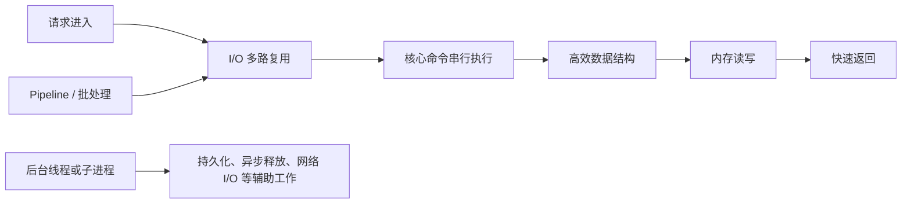

---

## 3. 数据类型、命令、底层结构与场景

### 3.1 高频结构总表

| 类型 | 高频命令 | 典型场景 | 主要底层编码/结构 |
|---|---|---|---|
| String | `SET`、`GET`、`MGET`、`INCR`、`SET NX EX/PX` | 对象缓存、计数、Token、锁 | SDS；值可编码为 `int`、`embstr`、`raw` |
| Hash | `HSET`、`HGET`、`HMGET`、`HINCRBY`、`HSCAN` | 对象字段、配置、限流规则 | 小对象常用 listpack，大对象转 hashtable |
| List | `LPUSH`、`RPUSH`、`LPOP`、`BRPOP`、`LRANGE` | 队列、栈、最新列表 | quicklist，节点内部使用 listpack |
| Set | `SADD`、`SISMEMBER`、`SINTER`、`SUNION` | 去重、标签、共同好友 | 小整数集合 intset；也可用 listpack；大集合 hashtable |
| ZSet | `ZADD`、`ZINCRBY`、`ZRANGE`、`ZRANK` | 排行榜、权重、延迟任务 | 小集合 listpack；大集合 dict + skiplist |
| Bitmap | `SETBIT`、`GETBIT`、`BITCOUNT` | 签到、活跃标记 | String 位操作 |
| HyperLogLog | `PFADD`、`PFCOUNT`、`PFMERGE` | 近似 UV | 概率统计结构，有误差、不能返回成员 |
| GEO | `GEOADD`、`GEODIST`、`GEOSEARCH` | 附近门店、距离计算 | 基于有序集合索引 |
| Stream | `XADD`、`XREADGROUP`、`XACK`、`XPENDING` | 消费者组、轻量消息流 | radix tree + listpack |

Redis 当前官方数据类型还包括 JSON、Time Series、Vector Set 等能力；面试基础仍应先吃透 String、Hash、List、Set、ZSet 和 Stream。编码会随版本及数据规模变化，可以通过 `OBJECT ENCODING key` 验证，不能把某种编码说成永远固定。

### 3.2 底层结构必答点

#### SDS

- O(1) 获取长度。
- 二进制安全，不依赖 `\0` 判断内容结束。
- 通过容量管理减少频繁内存重分配。
- 适合字符串、序列化对象、图片字节和计数值。

#### Dict 与渐进式 rehash

Redis 的键空间和多种集合结构依赖哈希表。扩缩容期间同时维护新旧两张表，后续命令逐步迁移桶，避免一次性搬迁全部数据造成长时间阻塞。

#### Listpack 与 QuickList

- Listpack 使用紧凑连续内存，小数据时节省指针和对象开销。
- QuickList 把链表的两端操作能力与 Listpack 的内存效率结合起来。
- 大集合应避免全量 `LRANGE 0 -1`、`HGETALL`、`SMEMBERS`。

#### SkipList

ZSet 的大集合通常同时维护：

```text
Dict：member -> score，适合按成员快速定位
SkipList：score -> member，适合排序、排名和范围查询
```

---

## 4. 过期删除与内存淘汰

### 4.1 过期删除

Redis 使用两种机制配合：

1. **被动过期**：访问 key 时发现已过期，删除并按不存在处理。
2. **主动过期**：周期性从带 TTL 的 key 中抽样，删除已过期项。

它没有为每个 key 建立独立 Java 式定时任务，因为百万级定时器会带来明显 CPU 和内存开销。

### 4.2 淘汰策略

达到 `maxmemory` 后才触发淘汰，与“TTL 到期”不是同一件事。

| 策略族 | 说明 |
|---|---|
| `noeviction` | 不淘汰，新增写命令返回错误 |
| `allkeys-lru/lfu/random` | 从全部 key 中按近似 LRU、LFU 或随机淘汰 |
| `volatile-lru/lfu/random/ttl` | 只从设置了 TTL 的 key 中选择 |

Redis 的 LRU 是采样近似算法，不是维护完整双向链表的严格 LRU。选型必须结合访问分布和数据职责；不能淘汰的业务状态不要与纯缓存混用同一实例。

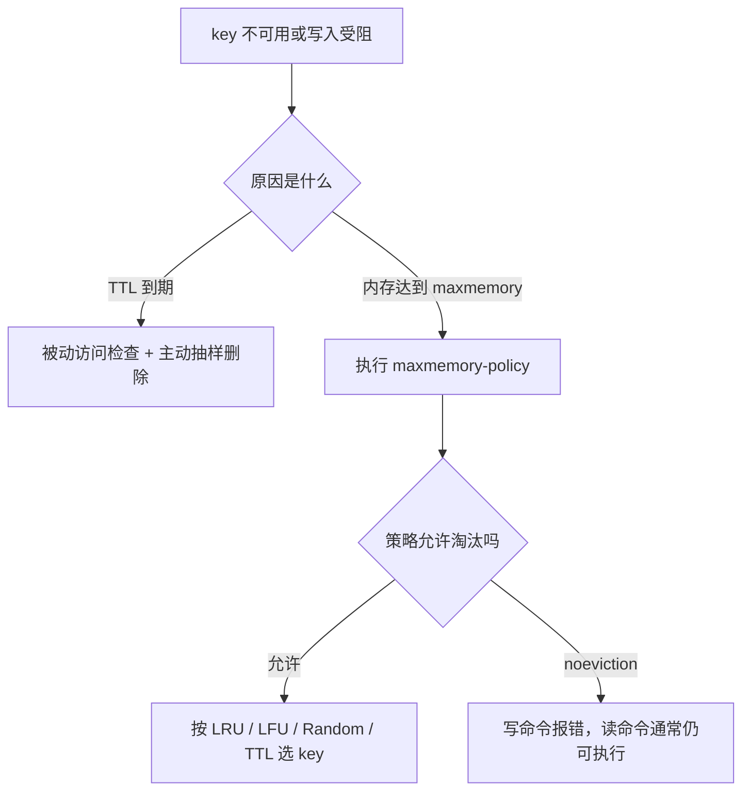

---

## 5. 持久化

### 5.1 RDB

RDB 是时间点快照。`BGSAVE` 通常由父进程 fork 子进程生成临时文件，再原子替换旧快照。

优点：文件紧凑、适合备份、全量恢复通常较快。缺点：两次快照间可能丢数据；大实例 fork 和 COW 会带来暂停、内存及磁盘压力。

### 5.2 COW

fork 后父子进程共享内存页。父进程收到写请求并修改某页时，操作系统复制该页。写入越密集，RDB 或 AOF rewrite 期间的额外内存压力越大。

### 5.3 AOF

AOF 记录写命令，常见刷盘策略为：

| 策略 | 可靠性与代价 |
|---|---|
| `always` | 每次写入刷盘，耐久性高、吞吐代价大 |
| `everysec` | 常用折中，故障时通常可能丢最近约 1 秒数据 |
| `no` | 交给操作系统决定，性能高、风险更大 |

AOF rewrite 根据当前数据集生成等价但更紧凑的新日志，不是简单压缩旧文件。Redis 7.0 起使用多段 AOF：一个 base 文件、一个或多个 incremental 文件，以及 manifest。

### 5.4 如何回答选型

```text
纯缓存、可从数据库重建
    -> 可以不持久化，重点做高可用和回源保护

允许丢最近几分钟、重视恢复速度和备份
    -> RDB

希望更小的数据丢失窗口
    -> AOF everysec

既需要备份恢复，也希望较高耐久性
    -> RDB + AOF，并验证恢复演练、磁盘和 fork 容量
```

---

## 6. 主从复制、Sentinel 与 Cluster

### 6.1 主从复制

复制默认是异步的。每个主节点以 `replicationId + offset` 标识数据历史；从节点重连时通过 `PSYNC` 请求：

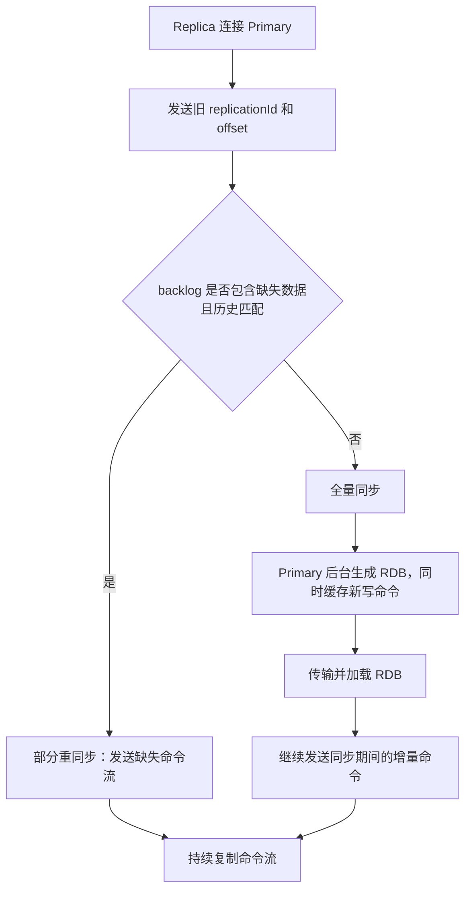

风险：主从延迟、故障切换窗口内写丢失、从库读旧值、backlog 太小导致频繁全量同步。

### 6.2 Sentinel

Sentinel 解决非 Cluster 架构的监控和自动故障转移：

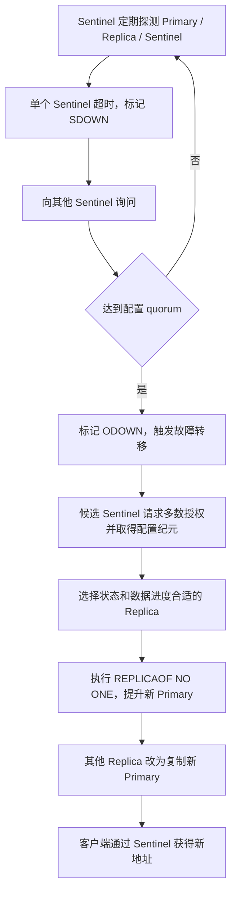

注意：`quorum` 用于判定 ODOWN；真正执行 failover 还需要多数 Sentinel 授权，两者不是同一个概念。

### 6.3 Cluster

- 固定 16384 个 hash slot。
- `slot = CRC16(key) mod 16384`，hash tag 可让多 key 落到同槽。
- 客户端收到 `MOVED` 后更新长期槽位映射；`ASK` 表示迁移期间的临时重定向。
- Master 间通过 Cluster Bus 和 gossip 传播状态。
- 主节点失败后，由其 Replica 请求其他 Master 投票，获得多数后晋升并接管槽位。
- Cluster 使用异步复制，仍存在已确认写在特定故障窗口内丢失的可能。

```text
Sentinel：一个写主节点 + 多从，解决自动切换，不解决水平分片
Cluster：多主分片 + 每主副本，同时解决容量扩展和高可用
```

---

## 7. Redis 分布式锁

### 7.1 正确的最小实现

```text
加锁：SET lock:key ownerToken NX PX leaseMillis
解锁：Lua 原子执行 GET 比较 ownerToken + DEL
```

ownerToken 防止 A 的锁过期后 B 获得锁，A 又把 B 的锁删掉。TTL 防止持锁进程崩溃造成永久死锁。

### 7.2 Redisson

Redisson 进一步处理：

- 可重入锁。
- 持有者校验。
- 未显式指定 leaseTime 时可通过 watchdog 续期。
- `tryLock(waitTime, leaseTime, unit)` 控制等待和租期。

但锁仍有边界：主从异步切换可能让锁记录尚未复制就丢失；业务时间超过固定租期可能出现并发持有者；高一致性场景还需要数据库唯一约束、状态机、幂等键或更强协调系统兜底。

---

## 8. 高频缓存问题

| 问题 | 定义 | 典型方案 |
|---|---|---|
| 穿透 | 缓存和数据库都不存在 | 参数校验、缓存空值、Bloom Filter、限流 |
| 击穿 | 单个热点 key 失效，大并发同时回源 | 互斥重建、逻辑过期、后台刷新、热点不物理过期 |
| 雪崩 | 大量 key 同时失效或 Redis 整体不可用 | TTL 抖动、多级缓存、高可用、预热、限流降级 |
| 双写不一致 | 数据库与缓存出现不同版本 | Cache-Aside、先更新库再删缓存、失败重试、binlog/MQ 补偿、TTL 兜底 |

### 8.1 Cache-Aside

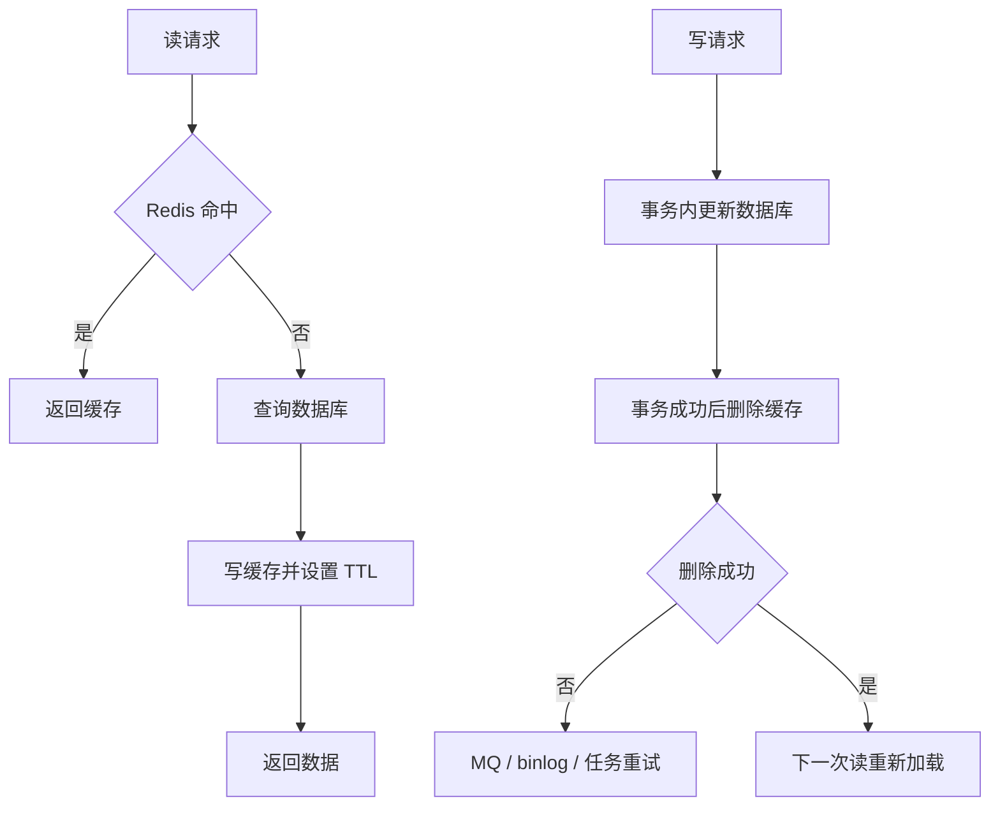

先更新数据库再删缓存仍然不是数学意义上的强一致；它是缓存场景中更常见的最终一致方案。核心数据还应依赖数据库约束和业务幂等。

### 8.2 Big Key 与 Hot Key

**Big Key** 会造成单次网络包大、主线程耗时、删除阻塞、复制和迁移变慢。使用拆分、分页/scan、`UNLINK`、集合容量限制。

**Hot Key** 会把负载集中到一个节点或槽位。使用本地缓存、多级缓存、副本读、热点副本拆分、预热、限流和降级。

---

## 9. 当前项目使用全景

扫描范围：`D:\ai-work-project` 下全部一级项目。以下为源码静态检索得到的 Redis 直接调用/配置文件命中数，用于判断使用密度，不等价于运行时调用次数。

| 项目 | 命中文件数 | 主要用途 |
|---|---:|---|
| `openapi-adapter` | 39 | 三方 Token 缓存、定时续期、Redisson 多实例互斥 |
| `ka-order` | 26 | 下单并发锁、运单/订单防重、业务缓存 |
| `ka-solution` | 25 | 消息幂等、字典/业务开关缓存、客户方案数据 |
| `ka-waybil-router` | 10 | 路由业务缓存、处理状态与辅助控制 |
| `ka-operation` | 8 | 运营配置和业务缓存 |
| `ka-monitor` | 7 | 监控配置、状态缓存、Redisson 配置 |
| `ka-common` | 6 | 统一锁工具、限流器、Redis 基础封装 |
| `ka-basic` | 2 | Redisson 基础配置和基础数据缓存 |
| `ka-query` | 2 | 查询结果缓存 |
| `gateway-server` | 2 | AOP 查询缓存、逻辑过期、锁重建、Bitmap/Hash/Set 工具 |
| `ka-consumer` | 1 | 消费侧辅助缓存 |
| `openapi-router` | 1 | 路由缓存切面 |

### 9.1 案例一：订单责任链中的分布式锁

源码：

- `ka-common/.../DistributedLockUtil.java`
- `ka-order/.../invoker/request/RedisLockInvoker.java`
- `ka-order/.../invoker/response/RedisUnLockResponseInvoker.java`
- `ka-order/.../OrderFactoryService.java`

调用链：

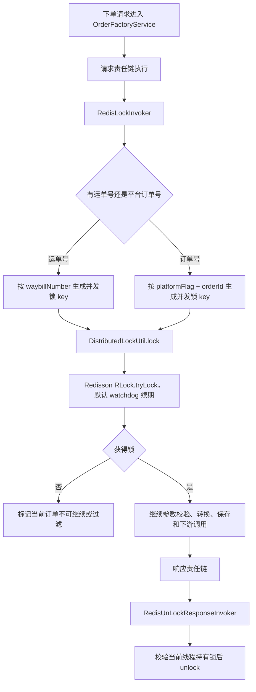

实际工作总结：该设计把“同一运单/同一平台订单不能并发下单”从业务方法抽成责任链节点。锁 key 使用业务唯一维度，成功后继续流程，最终在响应链统一释放，避免每个分支重复写锁逻辑。

### 9.2 案例二：网关查询缓存与热点重建

源码：

- `gateway-server/.../cache/ServiceCacheAspect.java`
- `gateway-server/.../utils/CacheUtils.java`

流程：

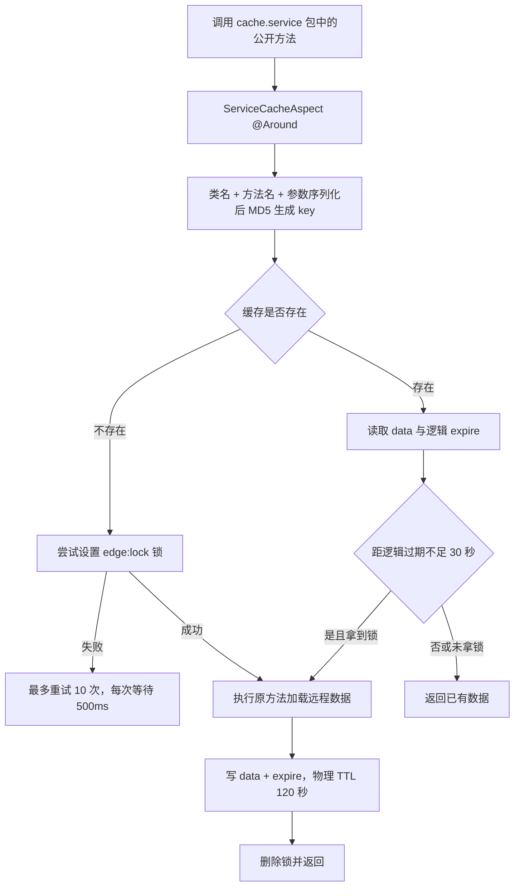

价值：热点数据接近过期时只允许一个请求重建，其他请求可继续使用旧值，降低缓存击穿概率。

边界：`CacheUtils.setIfAbsent` 当前是先 `setIfAbsent` 再单独 `expire`，不是一个原子命令；进程若在两步间退出，锁可能没有 TTL。应优先使用带 TTL 的原子 `setIfAbsent` 重载或 Lua。

### 9.3 案例三：开放平台 Token 续期

源码：`openapi-adapter/.../YeaStarTokenRefreshService.java`

```text
定时任务每 12 分钟触发
  -> 使用 Redisson 获取全局刷新锁
  -> 锁等待 10 秒、固定租期 20 秒
  -> 按本机 IP 读取 Token key
  -> 缓存不存在则调用三方申请 Token
  -> Token 写 Redis，TTL 25 分钟
  -> finally 仅由持有线程释放锁
```

实际工作总结：多实例部署下用全局锁避免同时刷新；Token 又按本机 IP 隔离，符合供应商 Token 与出口机器绑定的约束。固定 20 秒租期需要确保三方接口最坏耗时不会超过租期，否则应使用 watchdog 或更合适的租期。

### 9.4 案例四：统一限流

源码：`ka-common/ka-rate-limit/.../RateLimiteService.java`

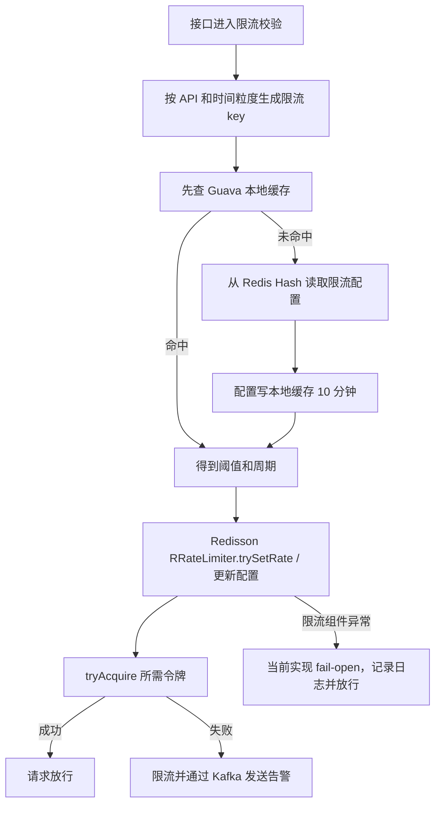

这是“本地缓存 + Redis 配置 + 分布式限流 + Kafka 告警”的组合，不是单一 Redis 命令示例。面试时应说明 fail-open 是可用性优先策略，资金或安全接口可能需要 fail-closed，必须按业务风险决定。

### 9.5 案例五：Kafka 消费幂等使用 Redis

源码：`ka-solution/.../NodeInfoListener.java`

节点消息先使用 `messageId` 查询 Redis；存在则直接返回，不存在则写入 10 分钟幂等 key，再执行 SheIn 推送和网点信息入库。这是典型的“消息至少一次投递 + Redis 短期去重”。

边界：当前逻辑为先 `GET` 再 `SET`，并发消费者之间存在检查与写入窗口。更严格的实现应使用原子 `SET key messageId NX EX 600`，并结合数据库唯一约束或业务状态机，避免 Redis 故障或 TTL 到期后重复副作用。

---

## 10. 项目中两种锁实现的对比

| 实现 | 做法 | 适用判断 |
|---|---|---|
| `DistributedLockUtil` | Redisson `RLock`，校验当前线程持有，支持 watchdog 或显式租期 | 当前项目更稳妥的统一方案 |
| `RedisLockUtil` | Jedis `SET NX PX`，最多循环等待；解锁直接 `DEL key` | 历史实现，存在误删其他持有者锁的风险 |

实际工作中看到 `RedisLockUtil.unlock(key)` 要立即联想到：是否保存唯一 owner token，是否用 Lua 原子比较并删除。不要因为加锁使用了 `NX + PX` 就认为整个锁实现已经正确。

---

## 11. 复习流程图

### 11.1 总复习路线

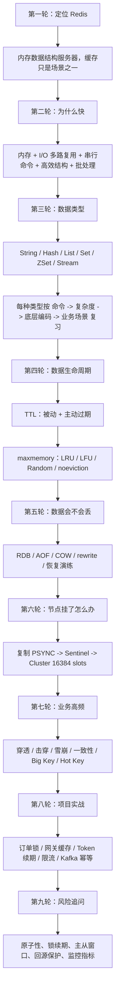

### 11.2 每个知识点的固定复习模板

```text
定义是什么
  -> 解决什么问题
  -> 核心数据结构或执行流程
  -> 关键命令/配置
  -> 优点
  -> 代价和失效边界
  -> 项目里哪个类使用
  -> 线上怎么监控和排查
```

### 11.3 每日 30 分钟复习法

1. 5 分钟默画 String/Hash/List/Set/ZSet 底层结构表。
2. 5 分钟口述 RDB、AOF、PSYNC、Sentinel、Cluster。
3. 5 分钟默写锁的 `SET NX PX` 与 Lua 解锁逻辑。
4. 5 分钟讲穿透、击穿、雪崩和一致性。
5. 10 分钟任选一个项目案例，从入口类讲到 Redis 命令、异常策略和风险边界。

---

## 12. 面试讲解流程图

### 12.1 3 到 5 分钟主线

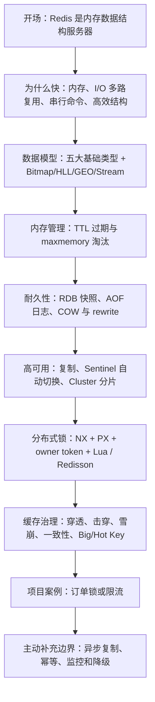

### 12.2 可直接口述的项目答案

> 我们项目里 Redis 不只是做查询缓存。订单模块通过责任链在下单前按运单号或平台订单号获取 Redisson 分布式锁，业务完成后在响应链统一释放，用来避免同一订单并发创建。公共模块还把限流配置放在 Redis Hash 中，本地用 Guava 做 10 分钟二级缓存，再通过 Redisson `RRateLimiter` 做分布式限流；限流失败会通过 Kafka 告警。开放平台适配器则用 Redis 缓存供应商 Token，并用 Redisson 锁协调多实例定时刷新。网关侧还有 AOP 查询缓存，通过逻辑过期和锁重建降低热点 key 击穿。
>
> 我们也关注实现边界：锁必须有 owner token 并原子解锁；固定租期要覆盖业务最坏耗时；缓存锁的 `SET NX` 和 TTL 必须原子；Redis 主从复制是异步的，所以强一致业务仍要用数据库唯一约束和幂等状态兜底。

### 12.3 常见追问连接图

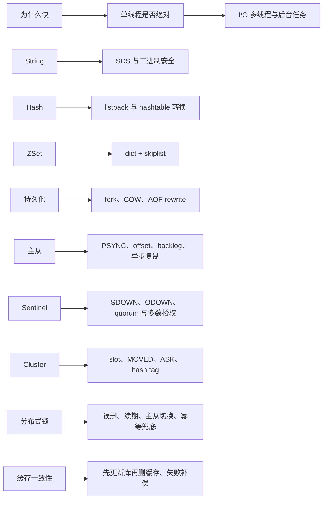

---

## 13. 高频自测题

1. Redis 为什么快？“单线程”应该如何准确描述？
2. Hash、Set、ZSet 在小数据和大数据下分别可能使用什么编码？
3. 过期删除和内存淘汰的触发条件有什么不同？
4. RDB、AOF、COW、AOF rewrite 各自解决什么问题？
5. `PSYNC` 如何决定全量还是部分重同步？
6. Sentinel 的 quorum 与多数授权为什么要分开？
7. Cluster 为什么是 16384 个槽，`MOVED` 与 `ASK` 有什么区别？
8. 为什么分布式锁不能直接 `DEL`？watchdog 解决了什么，没有解决什么？
9. 穿透、击穿、雪崩如何从现象上区分？
10. 为什么常用“先更新数据库，再删除缓存”？删除失败怎么办？
11. 当前项目 `ServiceCacheAspect` 如何避免热点同时回源？它的锁原子性风险在哪里？
12. 当前项目订单锁为何同时支持运单号和平台订单号两种 key？
13. `NodeInfoListener` 的 Redis 幂等为什么还需要数据库或状态机兜底？

---

## 14. 官方资料

- [Redis 数据类型](https://redis.io/docs/latest/develop/data-types/)
- [Redis 对象编码](https://redis.io/docs/latest/commands/object-encoding/)
- [Redis 过期机制](https://redis.io/docs/latest/commands/expire/)
- [Redis 内存淘汰](https://redis.io/docs/latest/develop/reference/eviction/)
- [Redis 持久化](https://redis.io/docs/latest/operate/oss_and_stack/management/persistence/)
- [Redis 主从复制](https://redis.io/docs/latest/operate/oss_and_stack/management/replication/)
- [Redis Sentinel](https://redis.io/docs/latest/operate/oss_and_stack/management/sentinel/)
- [Redis Cluster 规范](https://redis.io/docs/latest/operate/oss_and_stack/reference/cluster-spec/)
- [Redis 分布式锁](https://redis.io/docs/latest/develop/clients/patterns/distributed-locks/)

